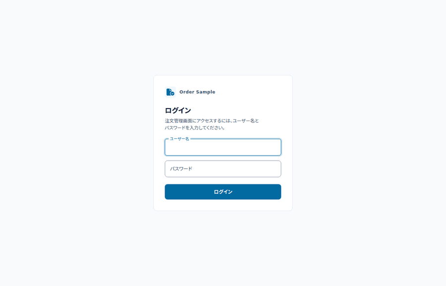

# Jakarta EE Order Sample（Quarkus メイン / Liberty・WildFly・GlassFish 対応）

Spring Boot を使わず、**Jakarta EE の仕様 API だけ**でオンライン処理とバッチ処理を実装したサンプルです。
メインの実行基盤は **Quarkus 3.40 LTS**、バッチは **Jakarta Batch 2.1**（Quarkiverse JBeret）で動かします。
ビジネスロジックと Web/Batch の実装は `order-core` に閉じ込め、**Open Liberty / WildFly / GlassFish でも同じコード**が動くようにしてあります。

- 性能とコンテナサイズ: [docs/performance.md](docs/performance.md)
- Jakarta Data 1.0 の導入検討: [docs/archive/jakarta-data-assessment.md](docs/archive/jakarta-data-assessment.md)
- Spring Boot との機能差の検討: [docs/archive/spring-parity-assessment.md](docs/archive/spring-parity-assessment.md)
- `main` は Quarkus をメインに、Open Liberty / WildFly / GlassFish のアダプタも同じリポジトリに含みます

| ディレクトリ | 実行基盤 |
|---|---|
| `order-quarkus` | Quarkus 3.40 |
| `order-liberty` | Open Liberty 26 |
| `order-wildfly` | WildFly 42 |
| `order-glassfish` | GlassFish 8 |

## 動作イメージ
ログイン → 商品一覧 → 請求書バッチ実行 → 請求書一覧 → 注文一覧の流れです。



### 実測サマリ

同一の core を 4 基盤 + native で動かし、**各ランタイムの最良設定**（プール 100、WildFly は Jackson）で
`wrk -t4 -c100 -d10s` を測定（ウォームアップ後、3 回の中央値）。認証は JWT。

| ランタイム | 起動 | 起動直後 RSS | status（認証なし） | me（認証のみ） | products（認証 + DB） |
|---|---:|---:|---:|---:|---:|
| **Quarkus 3.40.1.1（JVM / Quarkus REST）** | 3.05 秒 | 267 MB | **161,749** | **138,730** | **14,731** |
| **Quarkus 3.40.1.1（native）** | **1.17 秒** | **132 MB** | 96,929 | 81,077 | 10,544 |
| Open Liberty 26（feature 最小） | 6.19 秒 | 463 MB | 42,275 | 54,575 | 10,564 |
| WildFly 42（Jackson / slim） | **6.01 秒** | 502 MB | 62,465 | 55,610 | 11,147 |
| GlassFish 8 | 9.46 秒 | 534 MB | 27,177 | 24,483 | 3,626 |

- **JSON-P のプロバイダを 1 回だけ解決**するようにして、JWT 検証のコストを削減（`me` が約 12k → 138k）
- **HTTP/JSON 層は Quarkus（JVM）が最速**（status 161.7k）。native は 96.9k で、小さな JSON では JIT が勝る
- **DB を含む products も Quarkus が最速**（14.7k）。WildFly 11.1k、Liberty 10.6k、native 10.5k、GlassFish 3.6k
- **native は起動 1.17 秒・132 MB** で JVM の 3.05 秒・267 MB より優位。スループットは JVM より低い
- 起動は WildFly **6.01 秒**（Galleon で slim 化）、Liberty **6.19 秒**（必要 feature だけに）
- **native では Jakarta Batch が動作しません**（`QuarkusJobRepository` で例外→停止）。API と画面は動作します
- 以前の 18,200 req/s などの数値は `ab` 測定で、20k 付近からクライアントがボトルネックでした。詳細は
  [docs/performance.md](docs/performance.md) を参照してください
- コンテナイメージの最小サイズ（native 176 MB / 転送 42 MB など）も同じページにまとめています

> 16 vCPU / 7 GB / WSL2、コア固定なし、DB 初期化、3 回の中央値です。`wrk -t4 -c100 -d10s` を使用しています。
> 2026-10-30 に Quarkus 3.40.1.1 で全ランタイムを測り直した値です（`scripts/bench.sh`）。


## 構成
```
order-sample/
├── order-api/        OpenAPI 定義から生成した DTO（+ 必要なら JAX-RS インターフェース）
├── order-domain/     JPA エンティティ（Jakarta Persistence のみ）
├── order-core/       Jakarta EE API だけで実装した本体（単体テストもここ）
│   ├── web/          JAX-RS リソース + エラーマッピング（Controller 相当）
│   ├── service/      CDI + @Transactional（Service 相当）
│   ├── repository/   EntityManager / JPQL を隠蔽（Repository 相当）
│   ├── batch/        Jakarta Batch の Reader / Processor / Writer / Batchlet
│   └── resources/
│       ├── META-INF/persistence.xml
│       ├── META-INF/batch-jobs/invoiceJob.xml
│       ├── META-INF/batch-jobs/orderImportJob.xml
│       └── META-INF/resources/index.html   ← 簡易 UI（Quarkus/Liberty 共通）
├── order-quarkus/    Quarkus 実行アダプタ（Quarkus 依存はここだけ）
├── order-liberty/    Open Liberty 実行アダプタ（WAR + server.xml + スケジューラ）
├── order-wildfly/    WildFly 実行アダプタ（WAR + jboss-web.xml + スケジューラ）
├── order-glassfish/  GlassFish 実行アダプタ（WAR + スケジューラ）
└── docs/             ランタイム比較などのドキュメント（archive/ は過去の検討資料）
```

依存方向は `web → service → repository → domain` です。Controller は Service だけを、
Service は Repository だけを参照し、JPQL や `EntityManager` は Repository に閉じ込めています。
Web の DTO は `order-api` の OpenAPI 定義から生成し、`order-core` はその生成物を利用します。

`order-core` は Quarkus に依存せず、Jakarta EE API と `order-api` / `order-domain` にだけ依存しています。
依存はアンブレラの `jakarta.jakartaee-api` ではなく**仕様ごとの API**（`jakarta.ws.rs-api` など）で、
`order-core` の `maven-enforcer-plugin` が Quarkus / Spring / Hibernate / EJB / Servlet の混入をビルド時に弾きます。
`order-core/src/test/java` にはコンテナ不要の単体テストがあり、`mvn -pl order-core -am test` が数秒で回ります。
セキュリティヘッダの値は `core/web/SecurityHeaders` が唯一の定義です（Quarkus は同じ値を `application.properties` に持ち、
`SecurityHeadersTest` が一致を検証します）。
Quarkus と Liberty の主な差分は次のとおりです（初期データ投入は CDI の `Startup` イベントで共通化しています）。

| 関心事 | Quarkus 側 | Open Liberty 側 |
|---|---|---|
| バッチ実行 | `quarkus-jberet`（Jakarta Batch 2.1 実装） | `batch-2.1` |
| スケジューラ | `quarkus.jberet.job."invoiceJob".cron` | Concurrency 3.1 `@Asynchronous(runAt = @Schedule(...))`（`InvoiceSchedule`） |
| 初期データ投入 | CDI `Startup` イベント（`StartupDataSeeder`、共通） | 同左 |
| EntityManager の注入 | Quarkus の組み込み Bean | Liberty の JPA コンテナが提供する CDI Bean |


## 動作環境
- Java 21（このリポジトリは `maven.compiler.release=21`）
- Maven 3.9+
- Docker は**任意**（ローカル実行で Docker Compose を使う場合のみ。テストは Docker 不要）

```bash
export JAVA_HOME=/usr/lib/jvm/java-21-openjdk-amd64
export PATH="$JAVA_HOME/bin:$PATH"
```


## PostgreSQL を起動
### 方法A: Docker Compose（任意）

```bash
docker compose up -d
docker compose ps
```

- DB: `orders`
- ユーザー: `orders`
- パスワード: `orders`
- ポート: `5432`

停止する場合:

```bash
docker compose down
```

DB も含めて初期化する場合:

```bash
docker compose down -v
```

### 方法B: Docker なし（Maven + Embedded PostgreSQL）

`io.zonky.test:embedded-postgres` は、Maven で取得した PostgreSQL のネイティブバイナリを
そのまま実行します。Docker デーモンもコンテナも不要です。

```bash
# 依存モジュールをローカルリポジトリへ入れる
mvn install -DskipTests

# PostgreSQL 17.11 を 5432 で起動（前面で動作し続ける）
mvn -pl order-quarkus -Pembedded-postgres test-compile exec:java
```

起動すると次の接続情報で待ち受けます。別ターミナルで Quarkus を起動してください。

- JDBC URL: `jdbc:postgresql://localhost:5432/orders`
- ユーザー: `orders`
- パスワード: `orders`
- 停止: `Ctrl+C`
- 初回はバイナリの展開が入るため数秒かかります
- PostgreSQL の `initdb` は root では実行できないため、**非 root ユーザー**で実行してください
- Docker Compose の PostgreSQL と同時に使わないでください（5432 が競合します）

ランチャーは `order-quarkus/src/test/java/com/example/order/EmbeddedPostgresLauncher.java` です。

### 方法の比較

| 方法 | Docker | 実 PostgreSQL | 向き |
|---|---|---|---|
| Embedded PostgreSQL（Zonky） | 不要 | ○ | テスト、Docker なしのローカル実行（このサンプル） |
| Testcontainers | 必要 | ○ | テスト（Docker 前提） |
| Docker Compose | 必要 | ○ | ローカル開発 |
| OS に直接インストール | 不要 | ○ | ローカル / CI のサービス |
| H2 の PostgreSQL 互換モード | 不要 | × | 簡易テストのみ（非推奨） |


## Quarkus で起動
```bash
mvn clean package
java -Dorder.demo-users=true -jar order-quarkus/target/quarkus-app/quarkus-run.jar
```

`-Dorder.demo-users=true`（環境変数なら `ORDER_DEMO_USERS=true`）はデモユーザーを作るためのローカル専用の設定です。

- 画面: <http://localhost:8080/>（ログイン、注文のステータス絞り込み、注文・商品・請求書のページング / ソート、バッチ実行に対応）
- UI は MUI のデフォルトテーマ（Roboto / `#1976d2` / 4px 角丸 / Elevation）に準拠し、モバイルではテーブルを横スクロール
- 描画は [lit-html 3.3.3](https://www.npmjs.com/package/lit-html) を `META-INF/resources/vendor/lit-html` に同梱して使用（ES モジュール、ビルド不要、BSD-3-Clause）。
  比較レポートは [docs/design.md](docs/design.md)
- アイコンは Font Awesome Free 6.7.2 の `file-circle-check` をインライン SVG で使用（ヘッダー / ログイン / favicon 共通、CC BY 4.0）
- Lighthouse（mobile / desktop、ログイン / ダッシュボード）: Performance / Accessibility / Best Practices / SEO すべて 100
- ログイン画面: <http://localhost:8080/login.html>
- API: <http://localhost:8080/api/products>
- DB: `jdbc:postgresql://localhost:5432/orders`
- 初回起動時に顧客 3 件、商品 4 件、前月の確定注文 3 件、当月の DRAFT 注文 1 件を投入します。ユーザーは [docs/usage.md](docs/usage.md) の「ログイン / 認証」にある設定に従って作成します。


開発モードで動かす場合:

```bash
mvn install -DskipTests
mvn -pl order-quarkus quarkus:dev
```

> `order-quarkus` は `order-core` / `order-domain` を JAR 依存として参照します。リアクタ経由で `quarkus:dev` を実行すると依存 JAR が見つからないことがあるため、先に `mvn install` してください。


## ドキュメント

| 知りたいこと | ドキュメント |
|---|---|
| API の使い方、認証、バッチ、OpenAPI、テスト | [docs/usage.md](docs/usage.md) |
| 4 基盤の起動・設定と共通の運用設定 | [docs/runtimes.md](docs/runtimes.md) |
| 性能比較（4 基盤 + native）とコンテナサイズ | [docs/performance.md](docs/performance.md) |
| 設計上の判断、既知の制約、Spring Boot との差、UI の比較 | [docs/design.md](docs/design.md) |
| 過去の調査（Jakarta Data / Spring Boot 詳細） | [docs/archive/](docs/archive/) |

## ライセンス

このサンプルは [MIT License](LICENSE) で公開しています。

同梱しているサードパーティ製のファイルは、それぞれのライセンスに従います。

- lit-html 3.3.3（BSD-3-Clause）: `order-core/src/main/resources/META-INF/resources/vendor/lit-html/`
- Font Awesome Free 6.7.2 のアイコン（CC BY 4.0）: ヘッダー / ログイン / favicon の SVG
